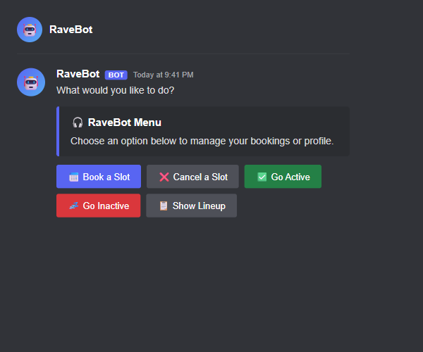
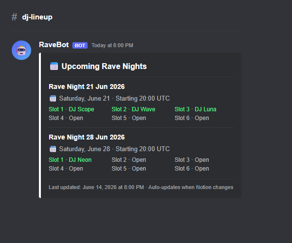

# RaveBot

Discord bot that automates DJ booking for recurring online rave events, onboarding, self-service slot booking, proactive outreach, and admin oversight, all via Discord slash commands and button-driven DM flows. Events, slots and DJs live in three Notion databases that the bot creates itself under one shared page (`NOTION_API_KEY` + `NOTION_PARENT_PAGE_ID`).

---

## The Problem

Running a recurring online rave means coordinating DJ lineups every single week: chasing availability, confirming bookings, filling last-minute gaps, and keeping everyone informed. Done manually, it's a full-time side job. RaveBot makes it automatic.

---

## How It Works

### Step 1, A DJ joins

When someone receives the "DJ" role in your Discord server, RaveBot DMs them automatically: *"Hey! I'm RaveBot, I handle all DJ bookings here. Want me to add you to the booking pool?"* They fill in a quick onboarding modal (DJ name, VRChat name, logo, stream links) and are ready to book. No admin involvement needed.

### Step 2, They book a slot

Any time a DJ wants to play, they DM RaveBot. A button-driven menu guides them through picking an event and a slot in seconds. Booking is race-condition safe, two DJs can't grab the same slot simultaneously. Cancellations work the same way.

### Step 3, Gaps get filled automatically

Before each event, RaveBot scans for open slots and DMs eligible DJs who haven't been contacted recently. It respects configurable cooldowns so DJs don't get spammed. Day-before reminders go out to everyone who is booked.

### Step 4, Admin sees everything

A live lineup post in your DJ channel updates automatically whenever Notion changes. The admin log channel shows bookings, cancellations, new DJs, problems and the DMs users send to the bot, with a `Reply` button. For edge cases, admins can force-book or free any slot with `/book dj slot` and `/cancel dj slot`. A guided `/setup` wizard configures the bot; until it is activated the bot stays idle.

---

## Screenshots

**DJ booking flow, button-driven DM interface**

**Lineup post, auto-updated when Notion changes**

---

## Features at a Glance

**For DJs**
- Automatic onboarding DM when "DJ" role is assigned
- Button-driven self-service booking and cancellation via DM
- Day-before event reminders
- Go active / go inactive at any time

**For Admins**
- Guided `/setup` wizard (channels, roles, event defaults, time zone, invites); the bot is idle until you activate it
- Admin log channel with a `Reply` button for DJ messages
- `/book dj slot` and `/cancel dj slot` to force-manage any slot
- `/automatic dj booking` to add or remove DJs from the automatic booking pool
- `/list all djs` for the DJ roster with booking status
- `/config show` to review all settings and the bot status
- `/create event` to manually create a Notion event
- `/post lineup update` to post the lineup on demand

**Automation**
- Keeps future events ready in Notion (default: every 7 days, 6 events look-ahead) and replaces events that are done or canceled
- Start times are local time (default Europe/Berlin)
- Auto-posts and updates the lineup embed whenever Notion changes
- Proactive outreach to fill open slots before each event
- Alembic database migrations run automatically at container start

---

## Slash Command Reference

| Command | Who | Description |
|---|---|---|
| `/setup` | Admin | Guided setup wizard; run again to change settings |
| `/config show` | Admin | Show all settings and the bot status |
| `/create event` | Admin | Manually create a Notion event for a specific date |
| `/post lineup update` | Admin | Post the lineup of the upcoming (or a chosen future) event |
| `/book dj slot` | Admin | Force-book a slot for any DJ |
| `/cancel dj slot` | Admin | Force-cancel any booking |
| `/list all djs` | Admin | List all registered DJs with booking status |
| `/automatic dj booking` | Admin | Add or remove a DJ from the automatic booking pool |

---

## Quick Links

[User Guide →](docs/user-guide.md) | [Developer Guide →](docs/developer-guide.md)

---

## Built With

[disnake](https://docs.disnake.dev/) · [asyncpg](https://magicstack.github.io/asyncpg/) · [httpx](https://www.python-httpx.org/) · [Notion API](https://developers.notion.com/) · PostgreSQL 16 · Docker · [uv](https://docs.astral.sh/uv/)

---

## License

Copyright © 2026 M4XXX.

RaveBot is licensed under the [GNU AGPL-3.0](LICENSE):

- **Free to use and change**, including commercially, as long as you follow the AGPL.
- **Share changes:** if you distribute a changed version, or run one as a service others use over a network (for example a Discord bot), you must offer your users the full source under the AGPL.
- **Credit:** keep the copyright and license notices.

This is a summary; the [LICENSE](LICENSE) text is what applies. To use RaveBot without these obligations, for example in a closed-source product, ask for a paid commercial license: see [COMMERCIAL-LICENSE.md](COMMERCIAL-LICENSE.md). Third-party dependencies keep their own licenses.
