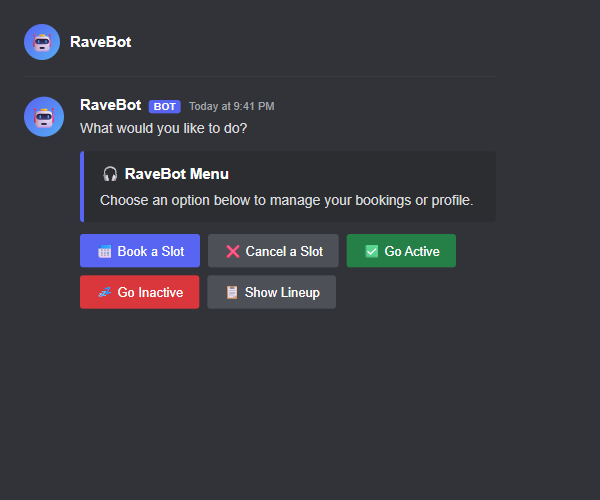
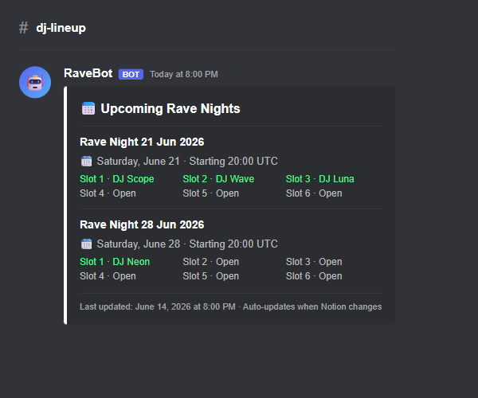
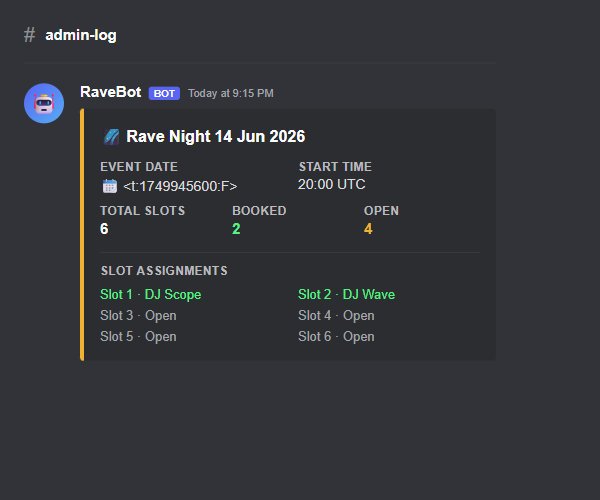

# RaveBot

Discord bot that automates DJ booking for recurring online rave events — onboarding, self-service slot booking, proactive outreach, and admin oversight, all via Discord slash commands and button-driven DM flows with Notion as the event database.

---

## The Problem

Running a recurring online rave means coordinating DJ lineups every single week: chasing availability, confirming bookings, filling last-minute gaps, and keeping everyone informed. Done manually, it's a full-time side job. RaveBot makes it automatic.

---

## How It Works

### Step 1 — A DJ joins

When someone receives the "DJ" role in your Discord server, RaveBot DMs them automatically: *"Hey! I'm RaveBot — I handle all DJ bookings here. Want me to add you to the booking pool?"* They fill in a quick onboarding modal (DJ name, VRChat name, logo, stream links) and are ready to book. No admin involvement needed.

### Step 2 — They book a slot

Any time a DJ wants to play, they DM RaveBot. A button-driven menu guides them through picking an event and a slot in seconds. Booking is race-condition safe — two DJs can't grab the same slot simultaneously. Cancellations work the same way.

### Step 3 — Gaps get filled automatically

Before each event, RaveBot scans for open slots and DMs eligible DJs who haven't been contacted recently. It respects configurable cooldowns so DJs don't get spammed. Day-before reminders go out to everyone who is booked.

### Step 4 — Admin sees everything

A live lineup post in your DJ channel updates automatically whenever Notion changes. Use `/status` for a quick embed showing slot assignments for the next event. Every bot↔DJ DM is mirrored to an admin log channel. For edge cases, admins can take over a DM conversation or force-book any slot.

---

## Screenshots

**DJ booking flow — button-driven DM interface**

**Lineup post — auto-updated when Notion changes**

**Admin /status — next event at a glance**

---

## Features at a Glance

**For DJs**
- Automatic onboarding DM when "DJ" role is assigned
- Button-driven self-service booking and cancellation via DM
- Day-before event reminders
- Go active / go inactive at any time

**For Admins**
- Full DM transcript log in admin channel (both directions)
- `/intervene` to take over any DJ DM conversation
- `/admin book` and `/admin cancel` to force-manage any slot
- `/admin dj set-active` to add/remove DJs from the booking pool
- `/status` for next-event overview (date, slots, DJ assignments)
- `/list-djs` for full DJ roster with active/inactive status
- `/config` with 11 sub-commands to tune every bot behaviour
- `/add-event` to manually create a Notion event

**Automation**
- Auto-creates future events in Notion on a configurable schedule (default: every 7 days, 6 events look-ahead)
- Auto-posts and updates the lineup embed whenever Notion changes
- Proactive outreach to fill open slots before each event
- Alembic database migrations run automatically at container start

---

## Slash Command Reference

| Command | Who | Description |
|---|---|---|
| `/config set dj-channel` | Admin | Channel where lineup posts are sent |
| `/config set log-channel` | Admin | Channel for admin alerts and DM transcripts |
| `/config set slots-per-event` | Admin | Slots per auto-created event (default: 6) |
| `/config set event-interval-days` | Admin | Days between auto-created events (default: 7) |
| `/config set lookahead-count` | Admin | Future events to maintain in Notion (default: 6) |
| `/config set start-time` | Admin | Default event start time in HH:MM UTC (default: 20:00) |
| `/config set slot-duration` | Admin | Slot length in minutes (default: 60) |
| `/config set outreach-days-before` | Admin | Days before event to begin outreach (default: 14) |
| `/config set outreach-cooldown-hours` | Admin | Hours between contacts per DJ (default: 12) |
| `/config set outreach-max` | Admin | Max DJs contacted per outreach cycle (default: unlimited) |
| `/config set event-schedule` | Admin | Cron expression for future automated scheduling |
| `/config show` | Admin | Display all 11 current config values |
| `/intervene start` | Admin | Take over a DJ's DM conversation |
| `/intervene send` | Admin | Send a message as the bot in an active intervention |
| `/intervene end` | Admin | Return DM control to the bot |
| `/admin book` | Admin | Force-book a slot for any DJ |
| `/admin cancel` | Admin | Force-cancel any booking |
| `/admin dj set-active` | Admin | Toggle a DJ's active/inactive status |
| `/status` | Admin | Embed showing next event: slots, date, DJ assignments |
| `/list-djs` | Admin | Embed listing all registered DJs with status |
| `/add-event` | Admin | Manually create a Notion event for a specific date |

---

## Quick Links

[User Guide →](docs/user-guide.md) | [Developer Guide →](docs/developer-guide.md)

---

## Built With

[disnake](https://docs.disnake.dev/) · [asyncpg](https://magicstack.github.io/asyncpg/) · [httpx](https://www.python-httpx.org/) · [Notion API](https://developers.notion.com/) · PostgreSQL 16 · Docker · [uv](https://docs.astral.sh/uv/)
